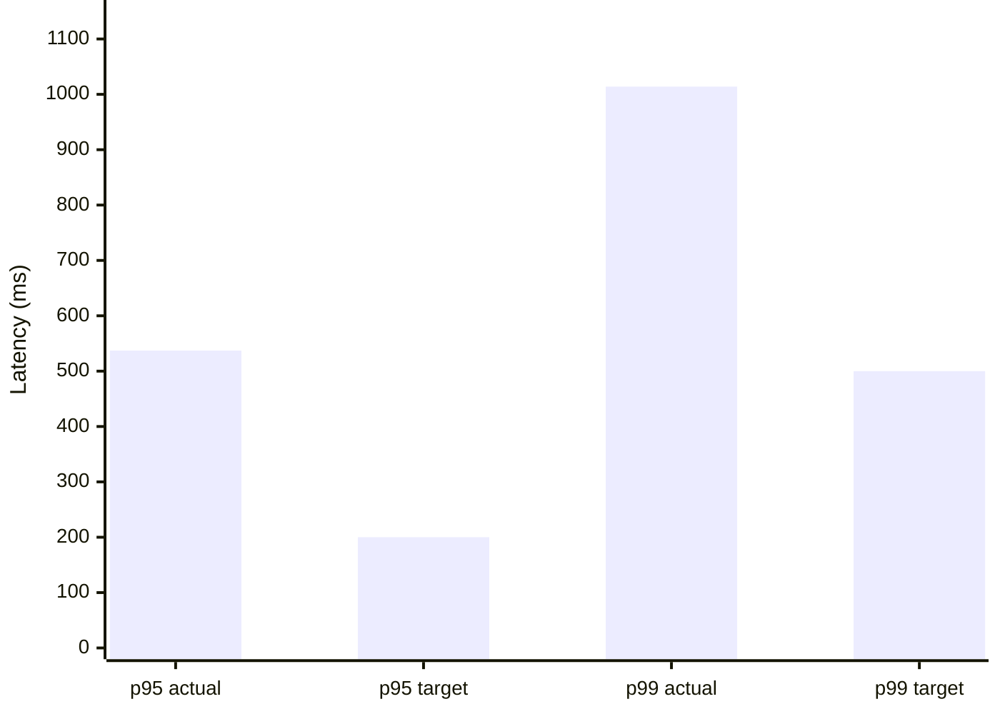
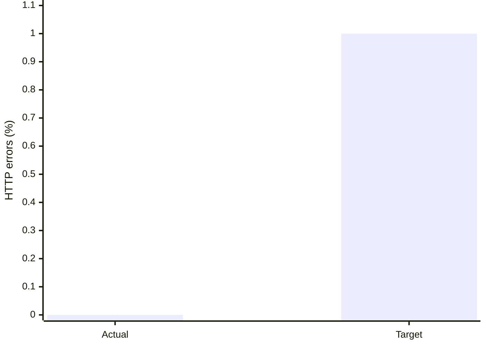
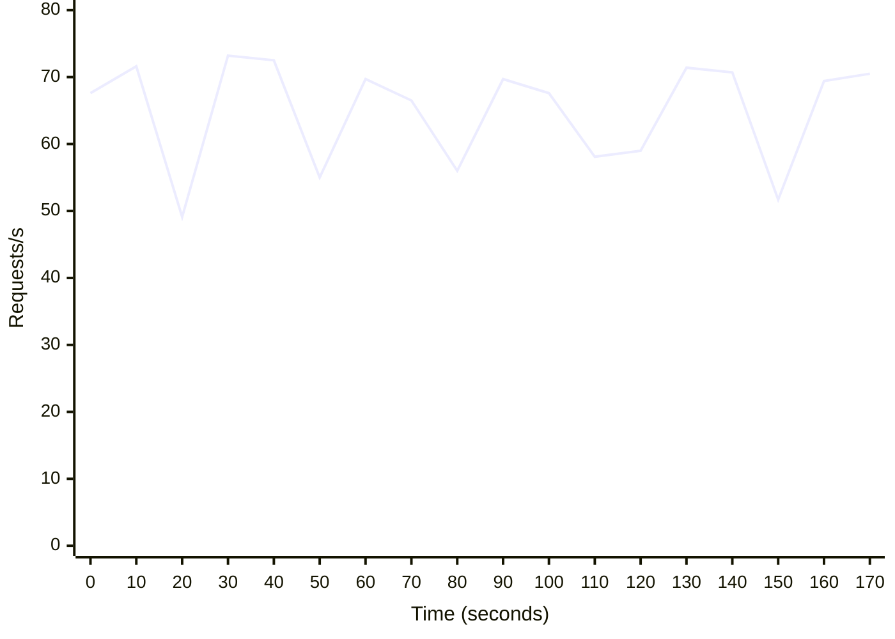

# CP3 k6 Performance Results

| Metric | Result | Target | Status |
| --- | ---: | ---: | --- |
| Load profile | 50 VUs for 180 seconds (195 seconds total incl. graceful stop) | 50 VUs for 180 seconds | Pass |
| Requests | 12464 total | — | Recorded |
| Fresh orders | 6232 created / 6232 cancelled | Each create gets one cancel | Pass |
| Throughput | 64.05 requests/s | — | Recorded |
| 10-second RPS range | 49.10-73.20 requests/s (37.1% of mean) | See chart | Variable |
| p95 latency | 537.14 ms | < 200 ms | Fail |
| p99 latency | 1014.01 ms | < 500 ms | Fail |
| HTTP error rate | 0.000% | < 1% | Pass |
| Overall latency/error thresholds | Fail | All targets above | Fail |

Each iteration creates a new order with a unique idempotency key and cancels that order once. The 50 VUs each use a different product/inventory row to avoid serializing all writes on one stock row. Supply 50 distinct active product IDs for the same restaurant, each with stock available throughout the run.

Test deployment: API and databases in Docker Compose, with k6 running in the Grafana k6 container on Windows.

## Latency chart

## Error-rate chart

## Request throughput over time

