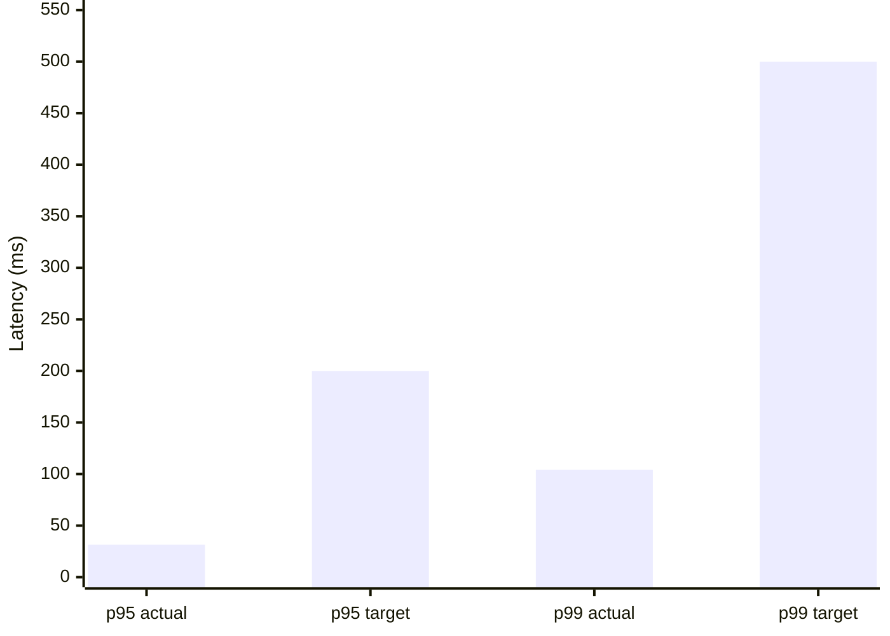
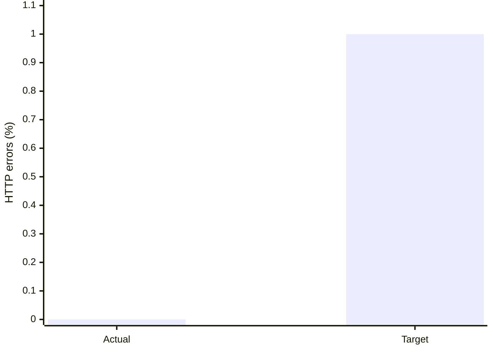

# CP3 k6 Performance Results

| Metric | Result | Target | Status |
| --- | ---: | ---: | --- |
| Load profile | 50 VUs for 181 seconds | 50 VUs for 180 seconds | Pass |
| Requests | 8,838 total | — | Recorded |
| Throughput | 48.77 requests/s | Stable over 3 minutes | Recorded |
| p95 latency | 31.48 ms | < 200 ms | Pass |
| p99 latency | 104.09 ms | < 500 ms | Pass |
| HTTP error rate | 0.000% | < 1% | Pass |
| Overall latency/error thresholds | Pass | All targets above | Pass |

Tested locally on Windows with Docker Desktop; API and PostgreSQL ran in Compose, and k6 ran in the Grafana k6 container.

## Latency chart

## Error-rate chart

